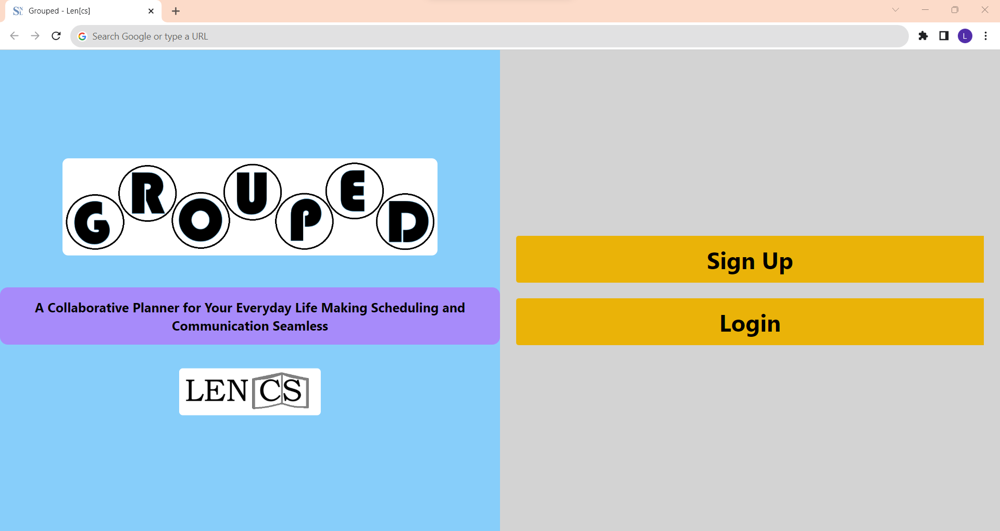
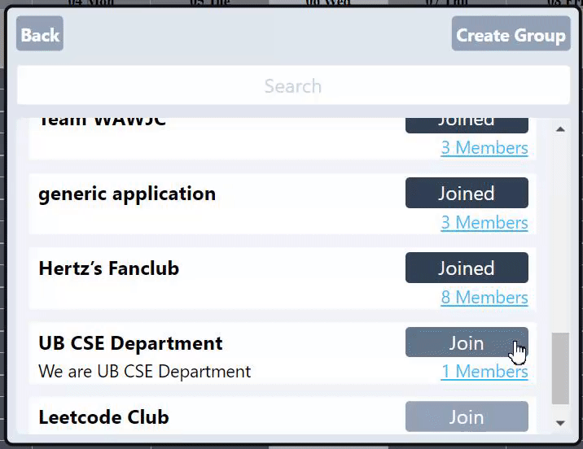
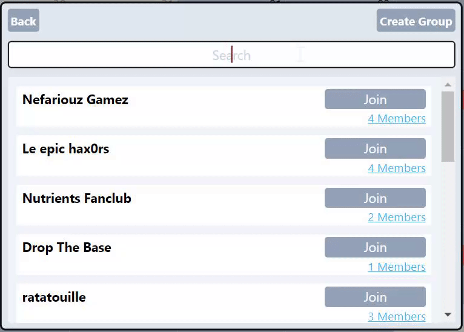
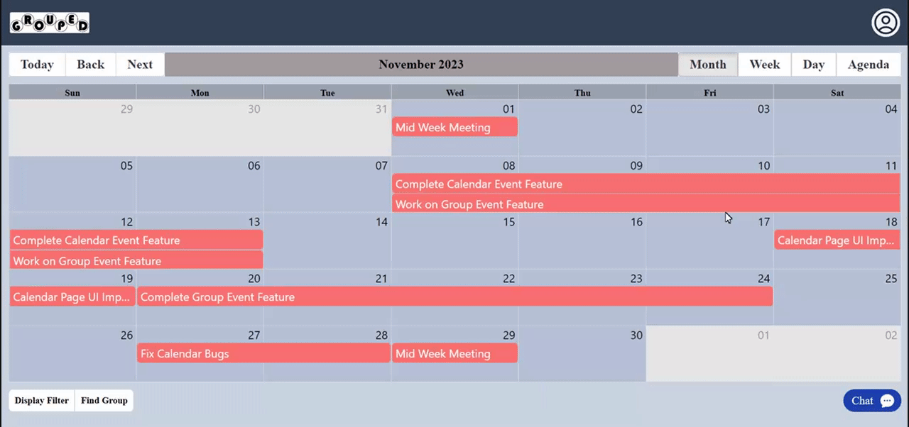
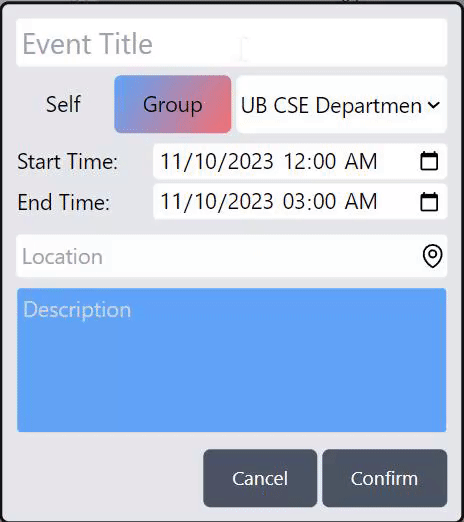
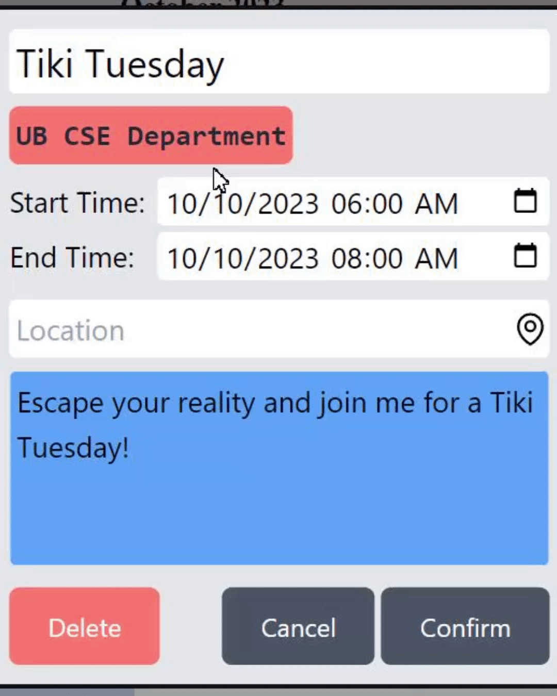
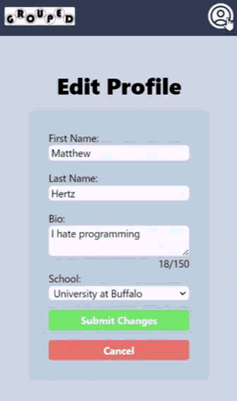
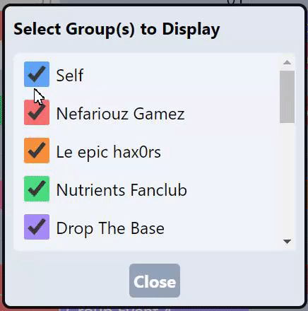
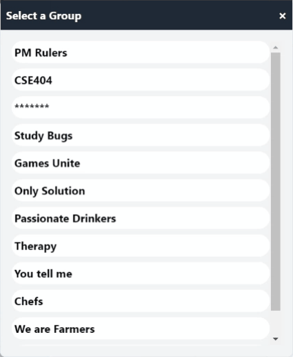

# Grouped

A collaborative planning platform for groups, organization, and teams.

**Overview**
Grouped is a full-stack web application designed to primarily help college students coordinate study sessions, meetings, activities, schedules, and communication within groups. Students can discover and join communities, manage events through an interactive calendar, communicate through built-in chat, and organize shared timelines.

Grouped was developed as part of CSE 442 at the University at Buffalo using a React frontend, PHP backend, SQL database, and Tailwind CSS.

## Features

**Group Discovery & Membership**: Students can browse available groups, search for communities, create new groups, and join existing organizations. The platform maintains a personal list of joined groups for quick access.

**Shared Project & Event Timeline**: Each group has access to a collaborative calendar system supporting:

- Event Creation
- Due date management
- Dynamic Calendar Views: Month, Week, Day, Agenda

Project timelines can be used to coordinate team deliverables and dealines.

**Event Management**: Students can create, edit, and delete events while specifying:

- Event title
- Start and end times
- Description
- Visibility scope: Personal, Group, Organization

**Profile Management**: Students can maintain a personal profile and modify account information through the application.

**Calendar Filtering**: To improve scheduling visibility, events can be filtered to display only information relevant to the student. This becomes especially useful when managing numerous groups and events simultaneously.

**Group Chat**: Integrated chat functionality that enables students to communicate without leaving the platform.

## Tech Stack

Frontend: React and TailwindCSS
Backend: PHP
Databse: SQL

## Contributors

Lorraine Gao
Neil Bae
Sovinder Singh
